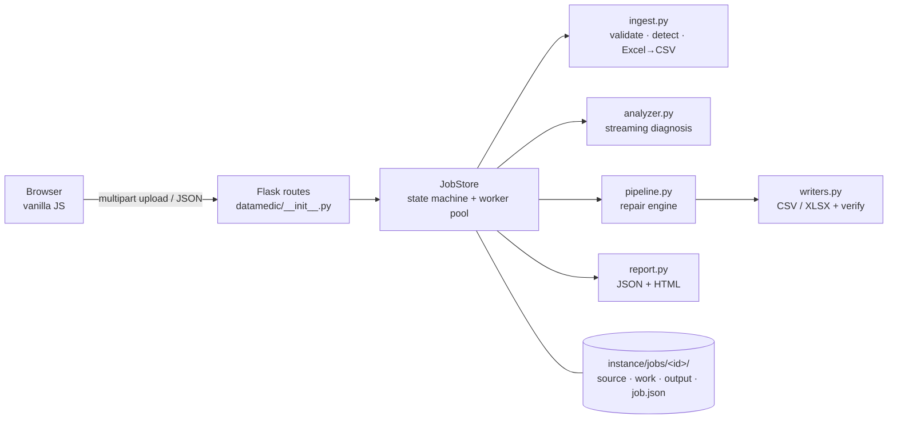

# Architecture



## One engine, three uses
`Pipeline` (pipeline.py) is the only code that transforms data. It is used for
1. **Preview** (`out_path=None`, dry run): same code, no output file, captures the first 40 rows as before/after.
2. **Export** (`out_path=…`): same code, writes the file.
3. **Tests** compare preview metrics with final metrics, so the two cannot drift.

`plan.resolve_plan()` turns the user's choices into a *resolved plan* using the diagnosis (e.g. which columns are safely numeric,
which date orders were resolved). Preview and export receive that same resolved plan.

## Data flow for a CSV
```
read_csv_chunks (strings only, positional columns)        <- original file, never modified
  └─ per chunk: trim → collapse → placeholders → numeric → dates → email case
       └─ duplicate mask  (DupTracker: sorted uint64 hashes, carried across chunks)
            ├─ no statistics needed → missing-value strategy → write chunk
            └─ mean/median/mode/zero → accumulate stats + write stage1.csv
                                          └─ pass 2: fill/drop with global stats → write chunk
output verified by re-reading (rows × columns) → atomic rename → reports written → state = completed
```
Everything is read as **text** (`dtype=str`, no NA parsing) so identifiers and leading zeros survive; "missing" has one definition
(empty or whitespace-only) in `patterns.is_missing`.

Excel: `ingest.prepare_excel` streams the first non-empty sheet into `work/ingested.csv` (openpyxl read-only / xlrd), then the
same chunk reader is used.

## Job state machine
```
uploaded → analyzing → analyzed → processing → completed
              │            ▲          │  ▲          │
              ▼            │          ▼  │          │
           failed(analysis)└─cancel─ failed(processing) ← retry / re-run allowed from analyzed, completed, failed(processing)
```
* Transitions are checked under a lock; invalid ones return HTTP 409.
* Starting a new run deletes the previous output first, so a stale result can never be downloaded for new settings.
* Downloads require `state == completed` **and** the file to exist and be non-empty.
* Output is written to `cleaned_partial.<ext>`, verified, then atomically renamed to `cleaned.<ext>`.

## Concurrency & storage
* `ThreadPoolExecutor(max_workers=2)` runs analysis and processing jobs; more jobs queue. Previews are limited by a semaphore (2).
* Each job has its own folder `instance/jobs/<uuid4-hex>/`; file names on disk are server-generated (`source.csv`), never user-supplied.
* `job.json` is rewritten atomically at state changes so the server can restart (running jobs become `failed: interrupted`).
* A daemon thread deletes jobs older than 24 h and orphan folders every 30 min.

## Why pandas (chunked) rather than DuckDB / Polars?
Measured, not assumed (see BENCHMARKS.md): chunked pandas holds ~280–380 MB peak RSS regardless of file size and processes
≈ 3 MB/s of analysis and ≈ 4.6 MB/s of cleaning on the test machine. The hardest requirement — correct cross-chunk duplicate
and imputation semantics with a per-cell audit trail — maps directly onto a chunk loop with explicit carried state.
DuckDB would speed up pure-SQL operations but would need the audit counters and Python regex/date logic re-implemented, adding
a dependency and a second code path for previews. It remains a documented future optimisation.

## Front end
Single page, three views, no framework. Rendering uses DOM builders and `textContent` only (uploaded values are untrusted);
a strict CSP (`script-src 'self'`, `style-src 'self'`) is sent with every response. Progress comes from `XMLHttpRequest.upload`
events (upload) and from the job's measured `rows done / total` (processing). The job id is kept in `localStorage`, so a refresh
resumes the same job.
